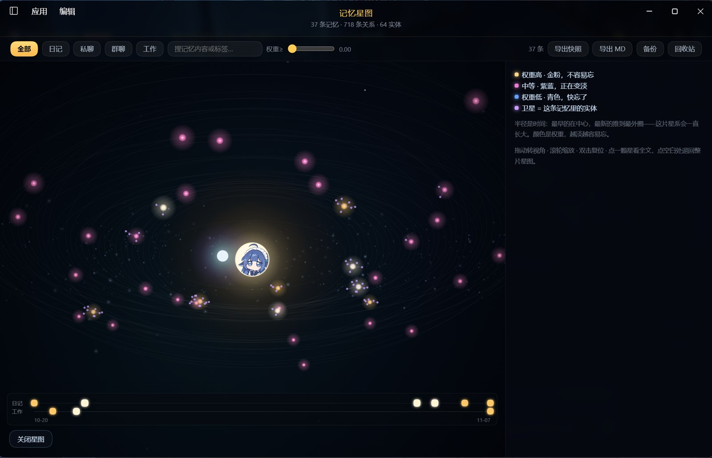

# dsh-memory-graph

> 把 AI 助手的记忆画成一片星空。**把 mnemon 记忆库渲染成可导航、可编辑的星图。**
>
> 不是仪表盘：颜色是权重的连续映射——青蓝是快忘了，金白是不容易忘。遗忘是显示权重，不是删除。



<sub>当前实测：37 条记忆 · 718 条关系 · 64 个实体。半径是时间（越新越靠外），颜色是权重（越淡越容易忘），中心一金一蓝两颗核。</sub>

---

## 它解决什么问题

AI 助手有记忆，但记忆锁在数据库里：看不见、不知道哪些重要、不知道哪些快被遗忘、换台机器就丢。

这个插件把 mnemon 的记忆库直接读出来，画成一张可交互的星图：

- **每个光点是一条记忆**，位置 = 时间（越新越靠外，星系会一直长大），颜色 = 权重（越淡越容易忘）
- **点开一颗星才出现连线**：默认不画线（718 条边全画就是一张蜘蛛网），选中后才亮起跟它相关的那些（时间 / 语义 / 因果 / 实体）
- **紫色小点是实体**（人、事、物），绕着它出现的那条记忆转
- 点一个光点，看它的内容、重要度、上次被调用是什么时候

设计原则只有一条：

> **遗忘 ≠ 删除。** 权重再低，数据也一条不减。变淡的意思是「不再自动跳到嘴边」，不是消失。

---

## 怎么工作

分两半，都很薄：

| 半边 | 文件 | 职责 |
|---|---|---|
| Host | `index.js` | 读 mnemon 的 SQLite，算权重，注册 web 路由返回 JSON；另有三条写路由管删除/恢复/编辑 |
| Client | `client.js` | 挂到 `shell.overlay`，把 JSON 画成星图 |

Host **默认只读**。只有三个动作会写库：编辑正文、软删除、恢复。三者都走同一条写路由工厂——校验 Host 必须是本机、只接受 POST、不批量改。

### 权重（遗忘曲线）

移植自 Ebbinghaus 式衰减，适配 mnemon 的 1–5 `importance`：

```
weight = importance/5 - min(rate, 0.03) * ageDays     地板 0.05
rate   = 0.008 * fresh * salience * review
fresh  = 1 / (1 + ageDays / 7)
salience = importance >= 3 ? 1.25 : 1.0
review   = 1 - 0.15 * min(access_count, 4)

importance >= 4 永不衰减
```

---

## 安装

需要 DSH（DeepSeek Harness）与本机安装的 `dsh-mnemon`。

```yaml
# cordis.patch.yml
- id: memory-graph
  module: '@you/dsh-memory-graph'
  config:
    dataDir: D:\dsh-memory\data
```

`dataDir` 指向 mnemon 的库目录（含 `mnemon.db` 与 `.dsh-memory-bodies.json`）。

刷新页面，右下角出现一颗金星，点开。

---

## 功能

- **分区视图**：全部 / 日记 / 私聊 / 群聊 / 工作，只看某一类记忆
- **权重过滤**：滑杆拉高只看「重要的」，拉低连「快忘的」一起看
- **点星看详情**：正文、权重、重要度、访问次数、相关记忆（按 entity / temporal 分组）
- **编辑正文**：记错了可以手动改，即时生效
- **软删除 + 回收站**：删掉的先进回收站，随时能恢复
- **彻底删除 + 云端捞回**：彻底删了本地，云端副本还在——回收站里能一键整条捞回（连它的边一起）
- **时间轴**：日记与工作两条泳道，看记忆是怎么一天天长出来的
- **导出**：快照 JSON、Markdown、整库备份（`mnemon-merge-v1`，可直接导回）

## 关系是怎么来的（读图前必看）

当前 718 条边的构成：

| 类型 | 条数 | 来源 |
|---|---|---|
| temporal | 448 | 写入时间邻近，**自动生成** |
| entity | 266 | 共现实体，**自动生成** |
| semantic | 4 | 显式建立，人工判断 |

**前两类是自动连的，不是「这两条记忆真的有关」。** 连线多 ≠ 关系深——星图上边多，是因为机器在找邻近，不是因为它想明白了。真正的人工关系目前只有 4 条。

---

## 状态

v0.3 — 能看、能筛、能改、能删、能恢复、能备份。已知不足：

- [ ] **只能改不能加**：没法手动新增一条记忆
- [ ] **改完不立刻同步云端**：编辑/删除只改本地库，云端要等同步（≤30 分钟）。这期间另一台机器上的助手读到的还是旧内容
- [ ] 权重只用于显示，**没有接回 mnemon 的召回排序**
- [ ] 编辑不重算 embedding（当前库里没有向量，所以暂时无害；开了向量检索就必须补）
- [ ] 大库（>2000 条）未压测
- [ ] 没有自动化测试，全靠手测

## License

MIT
